[English](README.en.md) | **简体中文**

<picture>
  <source media="(max-width: 640px) and (prefers-color-scheme: dark)" srcset="assets/presentation/hero-mobile-dark.svg">
  <source media="(max-width: 640px)" srcset="assets/presentation/hero-mobile-light.svg">
  <source media="(prefers-color-scheme: dark)" srcset="assets/presentation/hero-dark.svg">
  
</picture>

**根据提供的 Agent 编辑日志标记 Git diff 区域，在 blame 旁展示来源，并保存审阅状态。**

`v0.1.0` · `Go 1.24+ / Git` · [MIT](LICENSE)

[Website](https://provmark.lei6393.com) · [Demo record](docs/demo-results.json)

## 为什么使用

Git 记录提交作者，但同一工作区内人和 Agent 可能交替编辑。provmark 根据日志与 diff 的行区间重叠补充来源标记，让审阅者找到需要检查的 Agent 区域；它依赖日志完整性，不会从代码本身判断作者。

## 架构

<picture>
  <source media="(max-width: 640px) and (prefers-color-scheme: dark)" srcset="assets/presentation/architecture-mobile-dark.svg">
  <source media="(max-width: 640px)" srcset="assets/presentation/architecture-mobile-light.svg">
  <source media="(prefers-color-scheme: dark)" srcset="assets/presentation/architecture-dark.svg">
  
</picture>

adapter 读取中性 JSONL 编辑事件，git 模块读取相对 HEAD 的工作区 diff，correlator 每个 hunk 生成一个 Stamp。重叠 Agent 事件的 hunk 标记 agent，其余默认 human。侧车 `.provmark.json` 保存范围、会话与 Reviewed；blame/review 读取该侧车。

源码入口：[cmd/provmark/main.go](cmd/provmark/main.go) · [cmd/provmark/hook.go](cmd/provmark/hook.go) · [internal/agent/adapter.go](internal/agent/adapter.go) · [internal/git/diff.go](internal/git/diff.go) · [internal/provenance/correlate.go](internal/provenance/correlate.go) · [internal/provenance/stamp.go](internal/provenance/stamp.go) · [internal/review/gate.go](internal/review/gate.go)

## 安装

需要 Go 1.24+、Git；下面的自包含演示还需要 Python 3。它在临时仓库中创建合成基线提交，不操作当前项目历史。

```bash
git clone https://github.com/SuperMarioYL/provmark.git
cd provmark
go build -o bin/provmark ./cmd/provmark
```

## 快速开始

演示创建两处相隔的文本修改，只为后一处提供合成 Agent 事件，执行 stamp、review 和 mark，再读取侧车核对状态。没有使用实际 Agent 日志。

```bash
python3 examples/presentation-demo.py
```

完整输入与执行步骤见上方命令及 [Demo 记录](docs/demo-results.json)。

## 使用

```bash
./bin/provmark stamp --from events.jsonl --vendor claude-code --dir .
./bin/provmark blame app.go --dir .
./bin/provmark review --dir .
./bin/provmark review --mark app.go:15-17 --dir .
```
实际输入事件每行格式为 `{"file":"app.go","start_line":15,"end_line":17,"session_id":"session-1","vendor":"claude-code"}`。范围为当前文件的一起始、包含结尾的行号；根据 review 的实际输出选择 mark 区间。

## 实际 Demo

<picture>
  <source media="(max-width: 640px) and (prefers-color-scheme: dark)" srcset="assets/presentation/process-mobile-dark.svg">
  <source media="(max-width: 640px)" srcset="assets/presentation/process-mobile-light.svg">
  <source media="(prefers-color-scheme: dark)" srcset="assets/presentation/process-dark.svg">
  
</picture>

### 盖章并保存审阅

两个 hunk 分别标记 human 与 agent；后者的未审阅计数从 1 变为 0。

```text
$ python3 examples/presentation-demo.py
1 unreviewed agent region(s):
  example.py:13-16  claude-code synthetic-agent

review with: provmark review --mark <file>:<start>-<end>
marked 1 agent region(s) reviewed in example.py:13-16
no unreviewed agent regions — clean to commit
{
  "human_hunks": 1,
  "agent_hunks": 1,
  "unreviewed_before": 1,
  "unreviewed_after": 0
}
```

## 能力与接入

<picture>
  <source media="(max-width: 640px) and (prefers-color-scheme: dark)" srcset="assets/presentation/integrations-mobile-dark.svg">
  <source media="(max-width: 640px)" srcset="assets/presentation/integrations-mobile-light.svg">
  <source media="(prefers-color-scheme: dark)" srcset="assets/presentation/integrations-dark.svg">
  
</picture>

vendor 可选 claude-code、deepseek-coder、qwen-coder，但名称表示注册的解析器，不证明已直接兼容其所有原生会话格式。init 提供 pre-commit 钩子安装入口，当前审阅模式不阻断提交。


## 配置

`--dir` 指定仓库，`--from` 指向事件日志，`--vendor` 选择解析器。stamp 检查 HEAD 后的已暂存与未暂存修改；侧车中的 commit_sha 表示 diff 基线。相同区域重新盖章时会尝试保留既有审阅状态。

## 路线图与范围

当前可盖章、展示 blame 并持久化审阅标记。更强的原生日志适配与提交时提示仍需继续验证；密码学来源证明和阻断提交不在当前能力内。

- 标记粒度是 diff hunk，可能包含上下文行；不是对每个字符的独立作者证明。
- 缺少或无法读取日志时 hunk 默认 human，不能把该标签当作已验证的人类作者。

 · [Recording script](docs/demo.tape)

## 许可证

[MIT](LICENSE)
