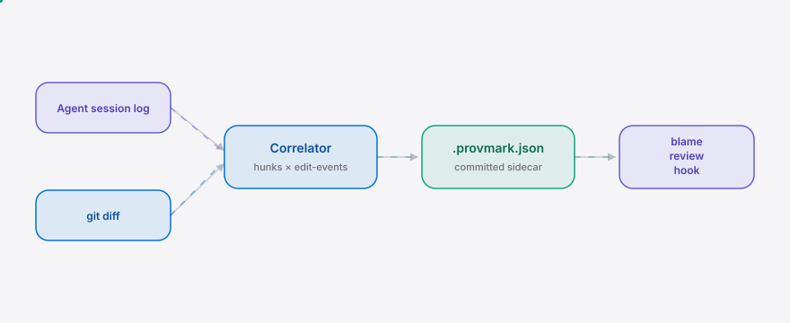

<div align="right"><sub>[English](./README.en.md) &nbsp;|&nbsp; <b>简体中文</b></sub></div>

<picture>
  <source media="(prefers-color-scheme: dark)" srcset="./assets/hero-dark.svg">
  <source media="(prefers-color-scheme: light)" srcset="./assets/hero-light.svg">
  
</picture>

<p align="center"><sub>provmark 是为代理编程开发者分离人类与代理行级作者归属的编辑级来源印章。</sub></p>

**AI 代理和你一起改了代码，`git blame` 却只显示提交者——provmark 在编辑级别为每处改动盖上人类或代理的来源印章，让评审关卡据此标记未审阅的代理改动。**

<p align="center">
  <a href="./LICENSE"></a>
  <a href="https://github.com/SuperMarioYL/provmark/releases"></a>
  <a href="https://github.com/SuperMarioYL/provmark/actions/workflows/ci.yml"></a>
  
</p>

## 目录

- [架构](#架构)
- [为什么是编辑级](#为什么是编辑级)
- [安装](#安装)
- [快速开始](#快速开始)
- [用法](#用法)
- [Demo](#demo)
- [路线图](#路线图)
- [许可](#许可)

<h2> 架构</h2>

<picture>
  <source media="(prefers-color-scheme: dark)" srcset="./assets/atlas-dark.svg">
  <source media="(prefers-color-scheme: light)" srcset="./assets/atlas-light.svg">
  
</picture>

一个 Go 二进制、一个进程。代理会话日志经适配器归一化成编辑事件，与 `git diff` 的 hunk 逐段对齐，盖成 `human`/`agent` 印章写进提交的 `.provmark.json` 侧车；`blame`、`review` 与 pre-commit 钩子都读同一份侧车。无服务器、无数据库、无守护进程——带来源归属的耐用记录就是那个提交的 JSON 文件。

<h2> 为什么是编辑级</h2>

当代理编辑占据一个 commit 的大多数行，`git blame` 把人和代理的改动压成同一个作者——它只能归属到提交者，看不出同一 commit 里哪几行是代理写的。这是结构性的，不是"还没做"：git 的对象模型是 commit→blob→tree，没有行来源字段。

provmark 补的就是这个缺失的字段：把代理会话的编辑事件与 `git diff` 的 hunk 逐段对齐，每段盖成 `human` 或 `agent` 写进提交的 `.provmark.json` 侧车。起点是 [anthropics/claude-code#66504](https://github.com/anthropics/claude-code/issues/66504)——一场 110 upvotes 的讨论，社区正是在反对"会话链接被默认塞进提交"。那场争点要的是提交里可审阅、可控的来源归属，而不是被当作副作用注入。`git blame` 给提交者；provmark 给编辑级的人类/代理归属。

<h2> 安装</h2>

```bash
go install github.com/SuperMarioYL/provmark@latest
```

或从源码构建：

```bash
git clone https://github.com/SuperMarioYL/provmark
cd provmark && go build ./cmd/provmark
```

<h2> 快速开始</h2>

在你的仓库里跑三行，就能看到 `git blame` 看不出的代理归属：

```bash
cd your-repo
provmark stamp --from agent-session.jsonl --vendor claude-code   # 盖章 → .provmark.json
provmark blame main.go                                           # 行级 human/agent 视图
```

<details><summary>示例输出</summary>

```
$ provmark stamp --from agent-session.jsonl --vendor claude-code
stamped 2 hunk(s) into .provmark.json
  agent: 1   human: 1   (diff base dea69c8)

$ provmark blame app.go
provmark blame app.go (git blame on left, author-kind on right)

LINE  KIND   COMMIT   GIT AUTHOR    CONTENT
1     human  dea69c8  You           package main
4     human  0000000  Not Committ…  	return "human typed this line"
14    agent  dea69c8  You           // 7
    agent: sess-abc (claude-code)
16    agent  dea69c8  You           func agentFn() string {
    agent: sess-abc (claude-code)
17    agent  0000000  Not Committ…  	return "agent generated this line"
    agent: sess-abc (claude-code)
```

</details>

<h2> 用法</h2>

`provmark` 的核心子命令（完整命令见 `provmark --help`）：

```bash
# 1. 盖章：把代理编辑事件与 git diff 对齐，写出 .provmark.json
provmark stamp --from agent-session.jsonl --vendor claude-code

# 2. 评审关卡：列出未审阅的代理改动；--mark 把一段标记为已审阅
provmark review
provmark review --mark app.go:15-17

# 3. 行级归属：git blame 旁显示每行 human/agent
provmark blame app.go

# 4. 初始化：安装 pre-commit 钩子（v0.1 为非阻塞桩）
provmark init
```

**代理编辑事件日志**是中性的 JSONL 契约——每行一条 `{"file","start_line","end_line","session_id","vendor"}`。`--vendor` 选适配器：`claude-code`（默认）、`deepseek-coder`、`qwen-coder`。格式以 `docs/absorption-probe.md` 为准对齐真实会话日志；日志读不出时优雅降级——所有 hunk 盖成 `human`，绝不硬失败。

> v0.1 契约：评审关卡只警告，永不阻塞提交；印章基于首次使用信任，不做密码学签名。

<h2> Demo</h2>

10 分钟从 `git clone` 到看见行级人类/代理归属——`git blame` 报告整段提交都是 "You"，provmark 却把代理写的几行点亮成 `agent`：


一键复现：`bash examples/stamp-review-demo.sh`（需要 `go` 与 `git`）。

<h2> 路线图</h2>

- [x] **m1 — 盖章 + 归属 + 评审标记**：`provmark stamp` 对齐代理编辑事件与 git diff 写出 `.provmark.json`；`provmark blame` 行级人类/代理视图；`provmark review` 标记未审阅的代理改动；吸收探针（`docs/absorption-probe.md`）。
- [ ] **m2 — 评审关卡持久化 + 钩子**：`review --mark` 持久化 `Reviewed` 状态；pre-commit 钩子在提交时警告（永不阻塞）未审阅的代理改动。
- [ ] **m3 — before/after 演示 + 双语发布**：`provmark blame` before/after 演示录制；中文 README + 英文 sibling；在 Show HN + 掘金 + V2EX 发布并种子 claude-code#66504 的 17 位评论者。

吸收探针是 m1 的 kill-trigger：若 Claude Code 或某国产代理已原生提供编辑级人类/代理归属 → 立即终止，因为 primitive 已被其依赖的 substrate 吸收。当前结论见 `docs/absorption-probe.md`。

<h2> 许可</h2>

MIT，见 [LICENSE](./LICENSE)。提 issue 或 PR 都欢迎。

<p align="center"><sub><a href="./LICENSE">MIT</a> © 2026 SuperMarioYL</sub></p>
